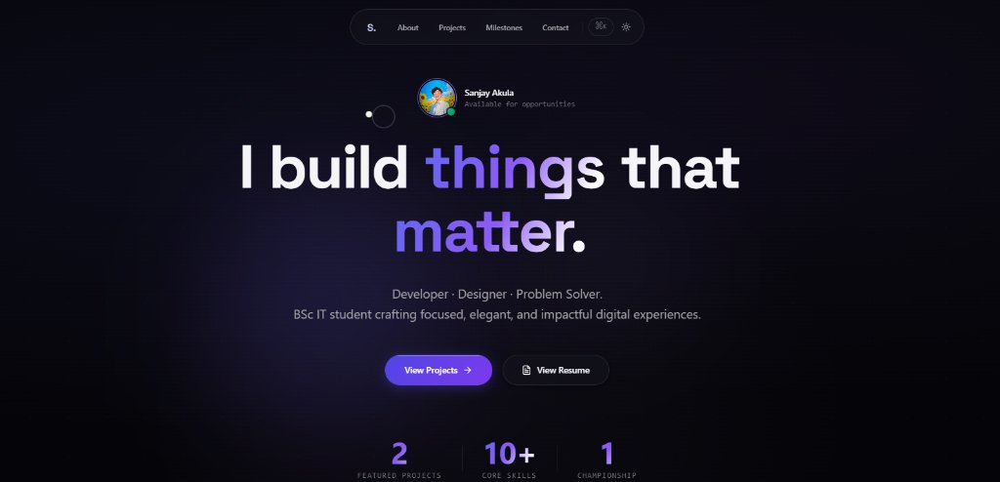

# Sanjay Akula — Software Developer Portfolio

<div align="center">



[](https://react.dev/)
[](https://vitejs.dev/)
[](https://tailwindcss.com/)
[](https://www.framer.com/motion/)
[](https://opensource.org/licenses/MIT)

**An Apple-inspired, performance-tuned personal developer portfolio engineered with React 19, Tailwind CSS v4, and Framer Motion.**

[Explore Live Demo](https://grace-of-christ-agy.vercel.app/) • [View GitHub Profile](https://github.com/subbaraoakula79-lang) • [Download Resume](public/resume.pdf)

</div>

---

## 📌 Overview

**Sanjay Akula Developer Portfolio** is a single-page web application showcasing production-grade software projects, system architectures, academic foundations, and athletic milestones. Built on Apple-grade design language, the interface emphasizes refined typography, glassmorphism (`backdrop-filter: blur(28px)`), GPU-accelerated spring motion, and accessible micro-interactions.

- **Developer:** Sanjay Akula
- **Academic Focus:** BSc Information Technology (2nd Year Ongoing, PR Degree College, Adikavi Nannaya University)
- **Primary Stack:** React 19, JavaScript (ESNext), Python, SQL, Firebase, Tailwind CSS v4
- **Specialization:** Full-Stack Web Development, System Portals, Responsive UI/UX Engineering, Algorithmic Problem Solving

---

## 🚀 Key Highlights & New Enhancements

### 1. 🖼️ Multi-Screenshot Project Gallery & Demos
- **National Admission Portal (NAP):** Full visual case study featuring a 5-screenshot carousel with interactive thumbnail selection and detailed capability breakdowns:
  1. **Landing Hero:** *"Your Future Starts with Smart Admissions"* (UG & PG application gateway).
  2. **Core Capabilities:** DigiLocker integration, AI Counselor, fair reservation system, multi-round allotment.
  3. **Pathway Selection:** Dedicated flows for Undergraduate, Postgraduate, Engineering, and Polytechnic Diploma.
  4. **Admin Console:** Real-time analytics for students, colleges, course allotments, payments, and audit logs.
  5. **Multilingual AI Counselor:** Instant guidance in English, Telugu, Hindi, and Tenglish.
- **Grace of Christ Church Platform:** High-resolution responsive banner, media-first sermon archives, and live production deployment on Vercel.

### 2. 🎨 Custom Brand Identity & OpenGraph Metadata
- **Monogram Favicon ("S"):** High-DPI squircle vector icon with violet-indigo gradient, subtle drop shadow, and crisp typography.
- **Social Preview Card (`og:image`):** 1200×630 SVG social card optimized for rich link previews across LinkedIn, WhatsApp, X (Twitter), and Discord.
- **Paper Airplane Send Animation:** Tactile message dispatch micro-interaction with takeoff flight trajectory and spring-animated feedback.

### 3. ⚡ 1-Click Clipboard Utilities
- **Instant Copy on Email & Phone:** One-click copy buttons with interactive `"Copied!"` tooltips and non-secure context fallbacks.
- **Ready for Real Email Delivery:** Built-in integration for [Web3Forms](https://web3forms.com), Formspree, or EmailJS to receive contact form messages directly in your inbox.

### 4. 🧠 Current Initiatives ("Now" Section)
- **Algorithmic Problem Solving:** Active LeetCode practice covering Arrays & Hashing, Two Pointers, Binary Search, Trees, and Recursion in Java & Python.
- **Full-Stack Engineering:** Scalable relational schema design (SQL) and cloud persistence with Firebase.

---

## 🛠️ Tech Stack & Architecture

| Layer | Technologies |
| :--- | :--- |
| **Frontend Framework** | [React 19](https://react.dev/) with functional hooks & concurrent features |
| **Build & Tooling** | [Vite 7](https://vitejs.dev/) with Rollup bundler & ESBuild |
| **Styling & Design System** | [Tailwind CSS v4](https://tailwindcss.com/) with CSS variables & `@theme` tokens |
| **Motion & Physics** | [Framer Motion 12](https://www.framer.com/motion/) spring physics, layout transforms & gesture recognition |
| **Icons & Typography** | [Lucide React](https://lucide.dev/), Space Grotesk, Inter, JetBrains Mono |
| **Deployment** | Compatible with [Vercel](https://vercel.com/) and [Firebase Hosting](https://firebase.google.com/docs/hosting) |

---

## 📁 Repository Structure

```
interactive-portfolio/
├── public/                       # Static public assets served at root
│   ├── favicon.svg               # Custom 'S' brand monogram vector icon
│   ├── hero-preview.jpg          # Live portfolio interface preview screenshot
│   ├── goc.png                   # Grace of Christ platform production screenshot
│   ├── nap-thumb.jpg             # National Admission Portal main thumbnail
│   ├── nap/                      # High-resolution demo screenshots (5 views)
│   │   ├── nap-hero.jpg          # Landing & Smart Admissions
│   │   ├── nap-features.jpg      # DigiLocker, AI Chatbot & Allotment features
│   │   ├── nap-admissions.jpg    # Admission types & pathways
│   │   ├── nap-admin.jpg         # Administrator analytics dashboard
│   │   └── nap-ai-counselor.jpg  # Multilingual AI Counselor modal
│   ├── og-image.svg              # 1200x630 OpenGraph / Twitter social share banner
│   ├── profile.jpg               # Professional headshot
│   └── resume.pdf                # Official technical resume (inline viewable)
├── src/
│   ├── components/
│   │   ├── layout/
│   │   │   └── Navbar.jsx        # Floating glass pill navbar with active section indicator
│   │   ├── sections/
│   │   │   ├── Hero.jsx          # Staggered headline reveal, live status badge, metrics
│   │   │   ├── About.jsx         # Narrative, education timeline & categorized skills
│   │   │   ├── Projects.jsx      # 3D interactive cards, variable-aspect multi-image modal
│   │   │   ├── Achievement.jsx   # Inter-University Archery Bronze medal showcase
│   │   │   ├── NowSection.jsx    # Real-time focus cards with DSA & full-stack topic tags
│   │   │   └── Contact.jsx       # Contact form, airplane takeoff animation, 1-click copy
│   │   └── ui/
│   │       ├── BackgroundEffect.jsx # Ambient gradient canvas & subtle dot matrix
│   │       ├── CommandPalette.jsx   # Global keyboard navigation modal (⌘K / Ctrl+K)
│   │       ├── CustomCursor.jsx     # Smooth spring cursor with blend mode
│   │       ├── MagneticButton.jsx   # Physics-based magnetic hover trigger
│   │       └── ScrollProgress.jsx   # Reading progress bar at top of viewport
│   ├── data/
│   │   ├── skillsData.js         # Decoupled skill sets, education, and metric constants
│   │   └── skillsData.test.ts    # Test suite verifying data integrity
│   ├── App.jsx                   # Root application wrapper & minimalist Apple footer
│   ├── index.css                 # Apple design tokens, glassmorphism, responsive utilities
│   └── main.jsx                  # Application entry point
├── index.html                    # Root HTML document with SEO, OpenGraph & preloads
├── package.json                  # Dependencies, build scripts & engine constraints
├── vite.config.js                # Vite configuration with @ path alias
└── README.md                     # Comprehensive documentation
```

---

## ⚡ Getting Started

### Prerequisites
- **Node.js**: `v18.0.0` or higher (Node 20+ LTS recommended)
- **npm**: `v9.0.0` or higher

### Installation
1. Clone the repository:
   ```bash
   git clone https://github.com/subbaraoakula79-lang/portfolio.git
   cd portfolio
   ```

2. Install dependencies:
   ```bash
   npm install
   ```

3. Launch development server:
   ```bash
   npm run dev
   ```
   Open [http://localhost:3000](http://localhost:3000) to view the portfolio.

---

## 📧 Configuring Real Email Delivery (Optional)

The contact form is configured to work out of the box with [Web3Forms](https://web3forms.com) (free, no backend required).

1. Get a free access key at [web3forms.com](https://web3forms.com) (enter your email `akulasanjay84@gmail.com`).
2. Create a `.env.local` file in the project root:
   ```env
   VITE_WEB3FORMS_ACCESS_KEY=your-access-key-here
   ```
3. Restart the dev server (`npm run dev`). Messages sent through the form will now arrive directly in your inbox.
*(If no key is configured, the form gracefully simulates successful submission with a local fallback notice).*

---

## 🔨 Available Scripts

- **`npm run dev`**: Starts the Vite local development server with Hot Module Replacement (HMR).
- **`npm run build`**: Compiles and bundles production-ready static assets in `dist/`.
- **`npm run lint`**: Runs ESLint across all JavaScript/JSX files with zero-tolerance rules.
- **`npm run preview`**: Serves the local production build for final verification.

---

## 🌐 Deployment

### Vercel (Recommended)
1. Push your code to GitHub.
2. Import the repository into [Vercel](https://vercel.com).
3. Framework Preset: **Vite**.
4. Click **Deploy**.

### Firebase Hosting
```bash
npx firebase login
npm run build
npx firebase deploy --only hosting
```

---

## 📄 License & Contact

Distributed under the **MIT License**.

- **Author:** Sanjay Akula
- **Email:** [akulasanjay84@gmail.com](mailto:akulasanjay84@gmail.com)
- **Phone:** [+91 8639064377](tel:8639064377)
- **LinkedIn:** [Akula Sanjay](https://www.linkedin.com/in/akula-sanjay-a6477b38a)
- **GitHub:** [@subbaraoakula79-lang](https://github.com/subbaraoakula79-lang)
